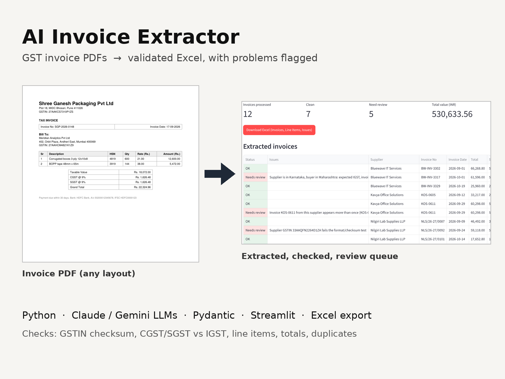
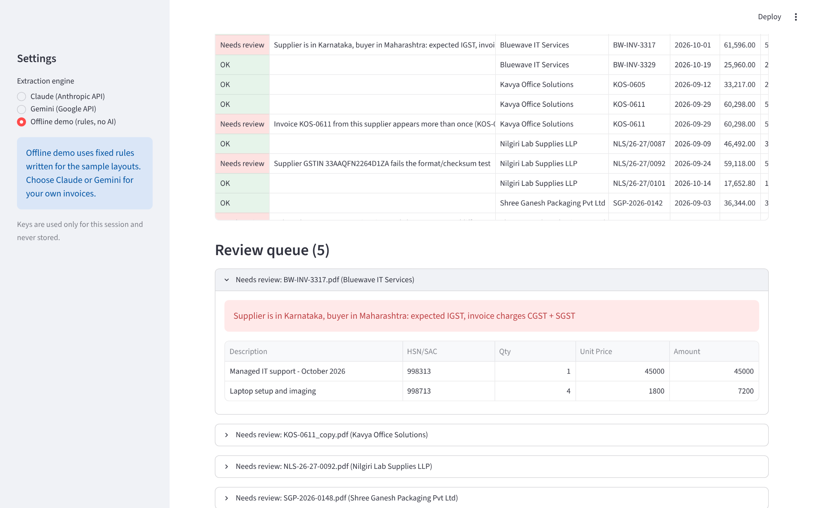

# AI Invoice Extractor

Turn a folder of GST invoice PDFs into one clean, validated Excel file. A large language model (Claude or Gemini) reads each invoice, whatever its layout, and pulls out the supplier, GSTINs, dates, line items and taxes. Every invoice is then checked for arithmetic, GST and duplicate errors before it reaches the spreadsheet.



## The problem

Accounts teams still type invoice data into Excel by hand. It is slow, and the errors that matter most get missed: a total that doesn't add up, IGST charged when it should be CGST + SGST, a mistyped GSTIN, or the same invoice paid twice.

## What it does

1. **Reads any layout.** Each supplier formats invoices differently. The LLM reads them like a person would, so there are no templates to maintain.
2. **Returns structured data.** The model must answer in a fixed schema (Pydantic), so every invoice comes back with the same fields and number types.
3. **Copies, never corrects.** The model is told to copy values exactly as printed, even wrong ones, so the checks below can catch them.
4. **Validates every invoice.**
   | Check | Catches |
   |---|---|
   | GSTIN format + checksum | Mistyped or fake GSTINs |
   | Supplier vs buyer state | IGST charged within a state, or CGST + SGST across states |
   | Qty × rate = line amount | Wrong line totals, misread numbers |
   | Line items = subtotal | Missing or extra lines |
   | Subtotal + tax = total | Wrong invoice totals |
   | CGST = SGST, standard GST rate | Odd tax splits and rates |
   | Same supplier + invoice number | Duplicate invoices in the batch |
   | Required fields, future dates | Incomplete or suspicious invoices |
5. **Exports to Excel** with three sheets: Invoices (colour-coded status), Line Items, and Issues.
6. **Handles scans.** If a PDF has no text layer, the PDF itself is sent to the model to read.



## Demo results

The `samples/` folder has 12 fictional invoices from 4 suppliers, each with a different layout, date format and labels. Five contain deliberate problems.

| Planted problem | Invoice | Caught |
|---|---|---|
| Total is ₹1,000 more than subtotal + tax | SGP-2026-0148 | ✅ |
| Line amount ≠ quantity × rate | SGP-2026-0161 | ✅ |
| Supplier GSTIN fails checksum | NLS/26-27/0092 | ✅ |
| Karnataka supplier charges CGST + SGST to a Maharashtra buyer | BW-INV-3317 | ✅ |
| Same invoice submitted twice | KOS-0611 | ✅ |

All 7 clean invoices pass with no false alarms. Run `python scripts/evaluate.py --engine claude` to measure field-level accuracy against `samples/ground_truth.json` with your own API key.

## Quick start

```bash
git clone https://github.com/Manjirigajmal/ai-invoice-extractor.git
cd ai-invoice-extractor
pip install -r requirements.txt
streamlit run app.py
```

Click **Try 12 sample invoices**. With no API key the app uses the **offline demo engine** (see below). For real invoices, choose Claude or Gemini and paste your key, or set it first:

```bash
export ANTHROPIC_API_KEY=...     # for Claude
export GEMINI_API_KEY=...        # for Gemini
```

**Batch from the command line:**

```bash
python cli.py path/to/invoices --engine claude --out march_invoices.xlsx
```

## Engines

| Engine | Use it for | Notes |
|---|---|---|
| `claude` | Real documents | Default model `claude-haiku-5-5`, change with `CLAUDE_MODEL` |
| `gemini` | Real documents | Default model `gemini-2.5-flash`, change with `GEMINI_MODEL` |
| `offline` | Trying the app with no key | Regex rules written for the 4 sample layouts only. A new layout will break it, which is exactly why the real engines use an LLM |

## Project structure

```
├── app.py                  # Streamlit app
├── cli.py                  # batch folder → Excel
├── extractor/
│   ├── schema.py           # Pydantic models: the fields we extract
│   ├── llm.py              # Claude + Gemini engines, prompt, structured output
│   ├── rules.py            # offline demo engine (no AI)
│   ├── validate.py         # GST, arithmetic and duplicate checks
│   ├── gstin.py            # GSTIN format, checksum, state codes
│   ├── pdf_text.py         # text layer vs scanned detection
│   ├── pipeline.py         # PDF → InvoiceResult, parallel batch
│   └── export.py           # formatted Excel output
├── samples/
│   ├── generate_invoices.py
│   ├── invoices/           # 12 fictional sample PDFs
│   └── ground_truth.json
├── scripts/evaluate.py     # accuracy vs ground truth
└── tests/                  # pytest, LLM calls mocked
```

## Tests

```bash
pytest -q
```

The 19 tests cover every validation rule, the full sample batch, the Excel export and both LLM engines. The LLM calls are mocked, so the tests need no API key or network.

## Privacy

Invoices are sent only to the API you choose. Anthropic's API and Google's paid Gemini API don't use your data for training by default, but Gemini's free tier may, so use a paid key for client documents and check the provider's current terms. Keys entered in the app are kept only for that session.

## Tech stack

Python · Claude / Gemini APIs · Pydantic · pdfplumber · Streamlit · pandas · openpyxl · pytest

All suppliers, GSTINs and amounts in `samples/` are fictional. The GSTINs have valid checksums but don't belong to real businesses.

## License

[MIT](LICENSE)
